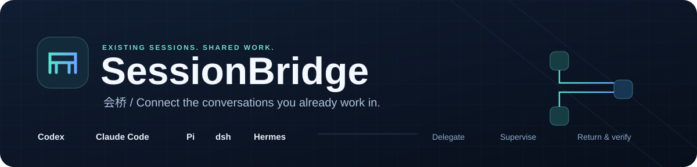
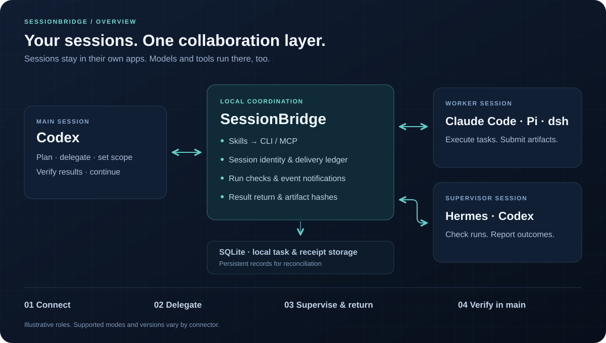

<p align="center">
  
</p>

<h1 align="center">SessionBridge · 会桥</h1>

<p align="center"><strong>Cross-session collaboration for the agent apps you already use.</strong><br />Delegate work, supervise runs, and bring results back to the original conversation.</p>

<p align="center">
  <a href="docs/support.en.md"></a>
  <a href="package.json"></a>
  <a href="docs/cli.md"></a>
  <a href="README.zh-CN.md"></a>
</p>

<p align="center">
  <strong>English</strong> · <a href="README.zh-CN.md">简体中文</a><br />
  <a href="#overview">Overview</a> · <a href="#quick-start">Quick start</a> · <a href="#agent-integrations">Integrations</a> · <a href="docs/cli.md">CLI reference</a> · <a href="docs/support.en.md">Compatibility</a>
</p>

---

**Keep the conversation. Share the work.** SessionBridge connects selected, existing agent sessions so one conversation can delegate a task, another can check a running job, and results can return to the original conversation for verification. Use it between two chats in the same app or across different agent apps.

Your apps keep their conversation history, models, accounts, and tool permissions. A local coordination service records tasks and delivery receipts; the bridge core makes no model API calls of its own.

> **Early access:** 0.1 is an integration prototype. Supported versions and session modes vary by app. Read the [compatibility guide](docs/support.en.md) before connecting a working session.

## Why SessionBridge?

| Capability | What it gives you |
| --- | --- |
| **Existing conversations** | Connect a chosen session by its native identity and keep its original context. Some apps require plugin activation or extension reload. |
| **Collaboration in plain language** | Use `sessionbridge-do` to select roles, delegate scoped work, or ask for progress. |
| **Same-app and cross-app tasks** | A shared task protocol with app-specific connectors and native routes where available. |
| **Quiet supervision** | Register an actual run, check its identity and receipts, and notify a supervisor when an outcome needs attention. |
| **Results back to the original chat** | Return summaries and artifact hashes for the main session to inspect and verify. |
| **Recovery with a record** | Persist task and message IDs locally; reconcile uncertain deliveries before taking further action. |

## Overview

<p align="center">
  
</p>

1. **Connect** the original sessions to the same project and give them clear aliases.
2. **Delegate** a task with acceptance criteria, allowed paths, and a deadline.
3. **Supervise** a registered run when needed; submit actual results and artifacts.
4. **Verify** in the original main session, then continue or assign a follow-up task.

**Skills** guide the agent. **CLI/MCP** expose operations. **Connectors** reach each app's native session interface. **SQLite** stores coordination records on your machine. The original applications execute the work.

## Quick start

### 1. Build from source

Requires **Node.js ≥24.15.0 and <25**, npm, and macOS or Linux. Individual agents and their model access must already be available.

```bash
git clone https://github.com/elan6666/Session-bridge.git
cd Session-bridge
npm ci --ignore-scripts
npm run build
npm run pack:plugins
node dist/src/cli/main.js --help
```

To install the generated local package into a prefix of your choice:

```bash
npm pack
npm install --prefix "$HOME/.local/sessionbridge" ./sessionbridge-local-0.1.0.tgz
export PATH="$HOME/.local/sessionbridge/node_modules/.bin:$PATH"
```

The PATH change applies to that terminal. In an already-open agent app, use the absolute executable path if `session-bridge` is not found. You can also run the source CLI as `node /absolute/path/to/Session-bridge/dist/src/cli/main.js`.

### 2. Prepare a project and enable the integrations

Replace `/absolute/path/to/project` with the directory you want the sessions to share.

```bash
session-bridge init --project /absolute/path/to/project

# Example: preview and install the Codex project integration.
session-bridge install --harness codex --scope project --project /absolute/path/to/project --dry-run
session-bridge install --harness codex --scope project --project /absolute/path/to/project
```

Use the relevant harness name for each app and follow the installation result's `next_steps` to enable its plugin or extension. Installation places the files; activation happens in the original app.

In a separate terminal, keep the local service running:

```bash
session-bridge daemon start --project /absolute/path/to/project
```

### 3. Connect the original conversations

For a Codex pair, ask **each original chat** to run its own connection command:

```bash
# In the main Codex conversation:
session-bridge connect --harness codex --alias main --project /absolute/path/to/project

# In the supervisor Codex conversation:
session-bridge connect --harness codex --alias supervisor --project /absolute/path/to/project
```

Run `connect` from the chat's native working directory, passing the shared project explicitly. Other apps enroll through their native plugin/extension entry points; see the integration table below. A session ID typed into an external terminal does not replace native enrollment.

### 4. Start collaborating

In the connected main Codex chat, with the Skill enabled:

```text
$sessionbridge-do Use this conversation as main and “supervisor” as the supervisor.
```

Then provide a concrete task:

```text
Ask the connected “supervisor” conversation to review the CSV validator.
Read src/ and tests/; write findings only to output/review.md.
Check missing-column and duplicate-ID handling, then return the result here.
```

The target alias must already be connected. The agent confirms the task details and deadline through the Skill. **Assigning roles alone does not create work or start monitoring.** Periodic supervision requires a specific run identity and an explicit check request.

## Agent integrations

A harness is the app environment running the agent. Entry syntax and activation differ between apps.

| Agent app | Skill entry | Connection route and boundary |
| --- | --- | --- |
| **Codex** | `$sessionbridge-do` | Original-chat `connect`; version-matched native queue. The original desktop remains the executor. Unloaded or archived chats are not guaranteed to wake. |
| **Claude Code** | `/sessionbridge-do` | Native plugin lifecycle and later inbox; explicitly enable the plugin and follow Claude's tool permissions. |
| **Pi** | `/skill:sessionbridge-do` | Native extension and follow-up delivery. Session switches or reloads invalidate the old binding. |
| **dsh** | “Use the sessionbridge-do skill…” | Cordis plugin bound to a selected native Agent; Web-mode integration, with desktop instances subject to separate checks. |
| **Hermes** | `/sessionbridge-do` | Native plugin and canonical gateway TUI queue. Busy injection in the ordinary CLI is restricted; desktop GUI attachment is unverified. |

See [versions, activation conditions, and limits](docs/support.en.md). Connecting a new managed worker is a different mode from attaching an existing conversation.

## Recovery and control

- **Uncertain delivery:** keep the original ID and use `recover`; inspect the queue/history before deciding what comes next.
- **Changed session:** reconnect after a native session or runtime changes. A recent-history entry is not a substitute for the selected identity.
- **Cancellation:** cancel future delivery or supervision; independent jobs continue running.
- **Sleep or app closure:** local processes pause during machine sleep. Automatic recovery depends on the original app, session state, and connector; closed or unloaded chats may need user action.
- **Verification:** a delivery receipt, model reply, and successful task acceptance are separate states. Inspect actual artifacts and test results in the original main chat.

Task data is stored in the project's private `.session-bridge/` directory. App permissions still apply. The scope checks help prevent misrouting and incorrect attribution; they do not provide a security sandbox against arbitrary programs running as the same OS user.

## Interfaces and documentation

| Resource | Use it for |
| --- | --- |
| [CLI reference](docs/cli.md) | Structured requests, reports, run receipts, supervision, recovery, and uninstall |
| [Compatibility guide](docs/support.en.md) | Per-app versions, lifecycle conditions, and current limits |
| [Natural-language Skill](skills/sessionbridge-do/SKILL.md) | The procedure used by a connected agent |
| [Adapter contract](https://github.com/elan6666/Session-bridge/blob/main/src/adapters/contract.ts) | Integrating another app's native session interface |

Ordinary projects use the built-in standalone task mode. Projects already using Byte can keep Byte as their ownership authority; availability depends on the supported helper and harness. See [optional project management integration](docs/support.en.md#optional-project-management-integration).

<details>
<summary><strong>Local checks</strong></summary>

```bash
npm run lint
npm run typecheck
npm test
python3 -m unittest discover -s tests/python
```

These checks do not call paid model APIs. Live diagnostics require an explicitly selected project, connected test sessions, and your own model/tool access.

</details>
