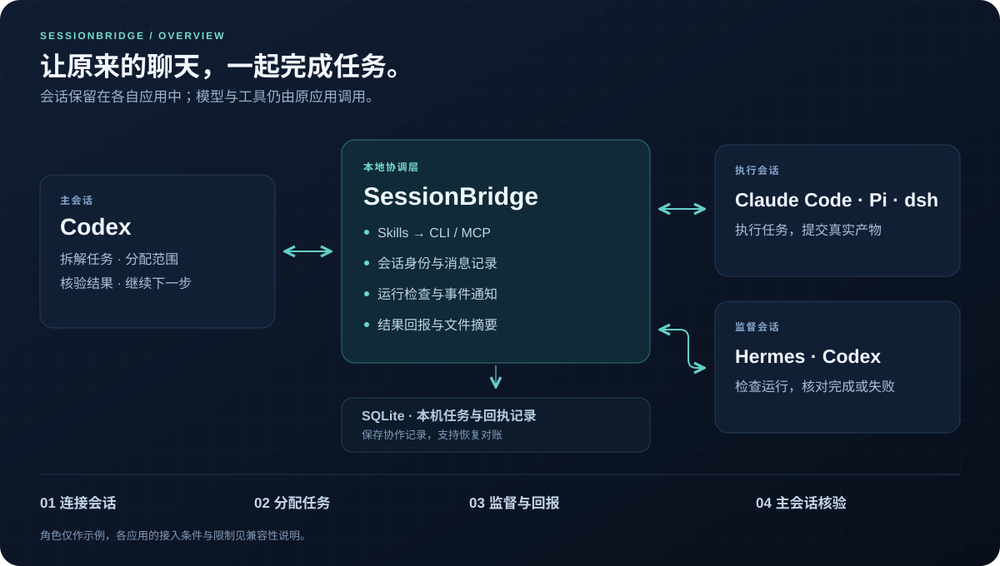

<p align="center">
  
</p>

<h1 align="center">会桥 · SessionBridge</h1>

<p align="center"><strong>让已经打开的 Agent 会话，一起完成任务。</strong><br />跨对话分工、检查运行进度，将结果送回原主会话。</p>

<p align="center">
  <a href="docs/support.md"></a>
  <a href="package.json"></a>
  <a href="docs/cli.zh-CN.md"></a>
  <a href="README.md"></a>
</p>

<p align="center">
  <a href="README.md">English</a> · <strong>简体中文</strong><br />
  <a href="#overview">协作总览</a> · <a href="#quick-start">快速上手</a> · <a href="#integrations">应用接入</a> · <a href="docs/cli.zh-CN.md">命令参考</a> · <a href="docs/support.md">兼容性</a>
</p>

---

**保留原来的聊天，让不同会话分工合作。** 会桥连接你选定的既有 Agent 会话：主会话分配任务，另一个会话监督运行，结果回到原主会话核验。既可以连接同一应用的两个聊天，也可以连接不同应用中的会话。

各应用继续保存自己的聊天记录，使用原来的模型、账号和工具权限。本地协调服务记录任务和投递回执，会桥内核自身不调用模型 API。

> **当前阶段：** 0.1 接入原型。不同应用的版本、会话模式和激活条件不同，连接工作会话前请先阅读 [兼容性与限制](docs/support.md)。

## 会桥能做什么？

| 能力 | 对用户的作用 |
| --- | --- |
| **接入既有会话** | 核对选定聊天的原生身份，保留原上下文；部分应用需要启用插件或重载扩展。 |
| **自然语言协作** | 通过 `sessionbridge-do` 设置角色、派发有明确范围的任务、查询进展。 |
| **同应用与跨应用分工** | 统一任务协议，分别对接各应用的原生接口；原生跨会话能力可用时优先复用。 |
| **安静地监督运行** | 登记真实作业，核对进程身份和运行收据，在完成、失败或需要处理时通知监督会话。 |
| **结果返回原主会话** | 回报摘要和文件哈希，由原主会话检查实际产物并验收。 |
| **有记录地恢复** | 本机持久保存任务和消息编号，投递不明时先对账，避免盲目重发。 |

<a id="overview"></a>

## 协作总览

<p align="center">
  
</p>

1. **连接会话**：各原聊天连接同一个项目，设置清晰的别名。
2. **分配任务**：说明验收条件、允许读写的目录和截止时间。
3. **监督与回报**：需要时监督已登记作业，提交实际结果和文件。
4. **主会话核验**：原主会话独立检查，通过后继续工作，或分配后续修复任务。

**Skill** 指导 Agent 按规则协作，**CLI/MCP** 提供操作入口，**连接器** 对接各应用原会话，**SQLite** 在本机保存协调记录。实际工作由原应用执行。

<a id="quick-start"></a>

## 快速上手

### 1. 从源码构建

需要 **Node.js ≥24.15.0 且 <25**、npm，以及 macOS 或 Linux。参与协作的 Agent 应用及模型访问需预先可用。

```bash
git clone https://github.com/elan6666/Session-bridge.git
cd Session-bridge
npm ci --ignore-scripts
npm run build
npm run pack:plugins
node dist/src/cli/main.js --help
```

可将生成的本地安装包装到自己选择的位置：

```bash
npm pack
npm install --prefix "$HOME/.local/sessionbridge" ./sessionbridge-local-0.1.0.tgz
export PATH="$HOME/.local/sessionbridge/node_modules/.bin:$PATH"
```

PATH 修改只对当前终端生效。已打开的 Agent 应用若找不到 `session-bridge`，请使用可执行文件的绝对路径。源码方式也可以运行 `node /源码绝对路径/Session-bridge/dist/src/cli/main.js`。

### 2. 准备项目并启用接入

将 `/absolute/path/to/project` 替换为希望各会话协作的项目目录。

```bash
session-bridge init --project /absolute/path/to/project

# 示例：先预览，再安装 Codex 项目接入文件。
session-bridge install --harness codex --scope project --project /absolute/path/to/project --dry-run
session-bridge install --harness codex --scope project --project /absolute/path/to/project
```

其他应用使用对应的 harness 名称，并按安装结果的 `next_steps` 在原应用中启用插件或扩展。安装负责放置文件，激活由原应用完成。

另开一个终端，保持本地服务运行：

```bash
session-bridge daemon start --project /absolute/path/to/project
```

### 3. 连接原来的聊天

以两个 Codex 聊天为例，让**各自原聊天**执行自己的连接命令：

```bash
# 在主 Codex 会话中：
session-bridge connect --harness codex --alias main --project /absolute/path/to/project

# 在监督 Codex 会话中：
session-bridge connect --harness codex --alias supervisor --project /absolute/path/to/project
```

从聊天原生工作目录运行 `connect`，通过参数明确指定协作项目。其他应用通过各自插件／扩展的原生入口登记，见下方接入表。在外部终端手填聊天 ID，不能代替原会话连接证明。

### 4. 用自然语言开始协作

在已连接且已启用 Skill 的 Codex 主聊天中输入：

```text
$sessionbridge-do 帮我用这个会话当主 Agent，
把“supervisor”会话设为监督者。
```

然后提出具体工作：

```text
让已连接的“supervisor”会话审查 CSV 校验工具。
允许读取 src/ 和 tests/，只把问题写到 output/review.md。
检查缺列和重复 ID 的处理，完成后把结果回报这里。
```

目标别名须已连接，Agent 会按 Skill 明确任务细节和截止时间。**只设置角色不会派任务或启动监督。** 周期监督需要具体运行身份与明确的检查要求。

<a id="integrations"></a>

## 应用接入

harness 指运行 Agent 的应用环境。各应用的 Skill 语法和启用方式有所不同。

| Agent 应用 | Skill 入口 | 连接方式与边界 |
| --- | --- | --- |
| **Codex** | `$sessionbridge-do` | 原聊天 `connect`，匹配桌面版本的原生队列；原桌面负责执行，未加载或归档聊天不保证唤醒。 |
| **Claude Code** | `/sessionbridge-do` | 原生插件生命周期和 later inbox；显式启用插件，工具权限由 Claude 管理。 |
| **Pi** | `/skill:sessionbridge-do` | 原生扩展与 follow-up 投递；会话切换或重载后旧连接失效。 |
| **dsh** | “使用 sessionbridge-do skill……” | Cordis 插件绑定指定原 Agent；Web 模式接入，桌面实例需分别核对。 |
| **Hermes** | `/sessionbridge-do` | 原生插件与 canonical gateway TUI 队列；普通 CLI 的忙碌注入受限，桌面 GUI 尚未验证。 |

完整版本与激活条件见 [兼容性与限制](docs/support.md)。另行启动受控执行者和接入既有聊天属于不同模式，不能混为一谈。

## 恢复与控制

- **投递结果不明**：保留原编号，用 `recover` 查询队列和历史，再决定后续操作。
- **会话发生变化**：原生会话或运行实例改变后重新连接，不能用最近历史代替目标身份。
- **取消**：取消未来派发或监督，独立作业继续运行。
- **休眠或应用关闭**：整机休眠会暂停本地进程；恢复取决于原应用、会话状态和连接器，关闭或未加载的聊天可能需要用户操作。
- **验收**：投递回执、模型回复与任务达标分别记录，原主会话需要检查真实产物和测试结果。

任务数据保存在项目私有的 `.session-bridge/` 目录。应用原有权限继续有效。范围核对用于防止误投和错误归属，不构成针对同一系统用户下任意程序的安全沙箱。

## 接口与文档

| 文档 | 内容 |
| --- | --- |
| [命令参考](docs/cli.zh-CN.md) | 结构化请求、报告、运行收据、监督、恢复与卸载 |
| [兼容性与限制](docs/support.md) | 各应用版本、生命周期条件与当前边界 |
| [自然语言 Skill](skills/sessionbridge-do/SKILL.md) | 已连接 Agent 实际遵循的操作步骤 |
| [连接器接口](https://github.com/elan6666/Session-bridge/blob/main/src/adapters/contract.ts) | 对接其他应用的原生会话能力 |

普通项目使用会桥内置的独立任务模式。已有 Byte 项目可保留 Byte 的工作权限记录，会桥负责传输、调度与回报；支持情况取决于 helper 和应用，见 [可选项目管理集成](docs/support.md#可选项目管理集成)。

<details>
<summary><strong>本地检查</strong></summary>

```bash
npm run lint
npm run typecheck
npm test
python3 -m unittest discover -s tests/python
```

这些检查不调用付费模型 API。真实接入诊断需要明确选择的项目、已连接测试会话，以及用户自己的模型与工具访问。

</details>
